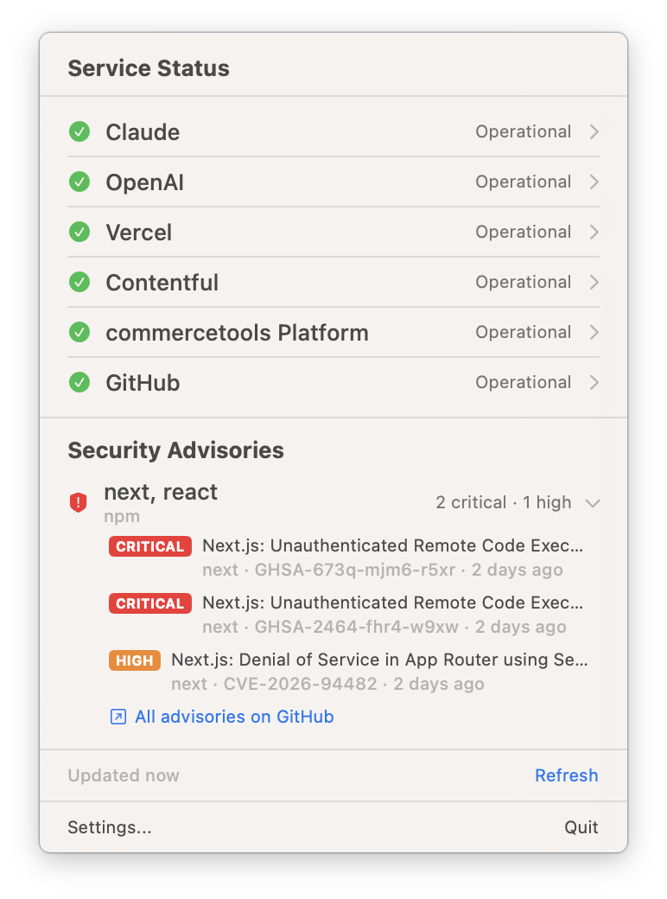

# StatusBar

A lightweight macOS menu bar app that monitors cloud service status pages at a glance.



StatusBar polls status page APIs from multiple providers, showing a colored icon in your menu bar reflecting the worst status across all monitored services. Click it to see per-service and per-component details. Just enter a status page URL — the provider is auto-detected.

  

## Features

- **Menu bar icon** that changes color based on overall status (green/yellow/orange/red/gray)
- **Five provider types** — auto-detected from URL (StatusPage, incident.io, status.io, Cachet, UptimeRobot)
- **Expandable service rows** with component-level breakdown
- **Quick links** to open status pages in your browser
- **Native notifications** when a service status changes (degradation or recovery)
- **Security advisories** — follow ecosystems or specific packages (e.g. `npm: next, react`) and see high/critical advisories from the [GitHub Advisory Database](https://github.com/advisories) published in the last 7 days; choose per topic whether to follow high, critical or both
- **Prioritized advisory notifications** — delivered as Time Sensitive so they can break through Focus (see [Security Advisories](#security-advisories))
- **Configurable polling interval** (30s to 10 minutes)
- **Add any supported status page** via Settings — just paste the URL
- **Launch at Login** — optional, toggle in Settings
- **Test notification** button in Settings to verify notification permissions
- **Translucent settings panel** with vibrancy background, adapts to light/dark mode
- **Zero dependencies** — built entirely with system frameworks

## Default Services

| Service | Domain | Provider |
|---------|--------|----------|
| Claude | status.claude.com | StatusPage |
| GitHub | eu.githubstatus.com | StatusPage |
| OpenAI | status.openai.com | incident.io |
| Vercel | www.vercel-status.com | StatusPage |

## Default Advisory Topics

| Ecosystem | Packages | Severities |
|-----------|----------|------------|
| npm | next, react | high, critical |

## Requirements

- macOS 14.0 (Sonoma) or later
- Xcode 16+ (to build from source)

## Getting Started

```bash
git clone <repo-url>
cd StatusBar
open StatusBar.xcodeproj
```

Press **Cmd+R** in Xcode to build and run.

### Building from the command line

Using [Task](https://taskfile.dev) (`brew install go-task`):

```bash
task build     # debug build
task release   # release build
task run       # build and open the app
task zip       # build release + create distributable zip
task clean     # clean build artifacts
```

Or directly with xcodebuild:

```bash
xcodebuild -scheme StatusBar -destination 'platform=macOS' build
```

## Usage

1. After launching, look for the status icon in your **menu bar** (top-right of screen)
2. **Click** the icon to see service details
3. **Click** a service row to expand and see individual component statuses
4. Open **Settings** to add/remove services, follow advisory topics, or change the refresh interval

The app runs as a menu-bar-only app — it won't appear in the Dock.

## Adding Services

1. Click the menu bar icon → **Settings...**
2. Enter the status page URL (e.g. `status.vercel.com`)
3. Click **+** — the provider and service name are auto-detected

### Supported Providers

| Provider | Example | Detection |
|----------|---------|-----------|
| [Atlassian StatusPage](https://www.atlassian.com/software/statuspage) | status.claude.com, eu.githubstatus.com | `/api/v2/summary.json` |
| [incident.io](https://incident.io) | status.openai.com | `/proxy/{domain}` |
| [status.io](https://status.io) | status.commercetools.com | `statuspageId` in HTML |
| [Cachet](https://github.com/CachetHQ/Cachet) | status.bluestonepim.com | `/api/v1/components/groups` |
| [UptimeRobot](https://uptimerobot.com) | uptime.storyblok.com | `pspApiPath` in HTML |

## Security Advisories

The **Security Advisories** section of the dropdown lists your followed topics. Click a topic to see its high and critical advisories with how long ago they were published; click an advisory to open it on GitHub.

Manage topics in **Settings → Advisories**: pick an ecosystem and optionally enter package names (comma separated). Leaving packages empty follows the whole ecosystem, which can be noisy — pip and npm each see dozens of high/critical advisories per week. Use the **High** / **Critical** chips on each topic to choose which severities it follows (both by default).

- Data comes from the public `GET https://api.github.com/advisories` endpoint (reviewed advisories only), no token needed.
- Unauthenticated requests are limited to **60 per hour**, and each topic uses one request per followed severity per check. The check interval is 15 minutes to 1 hour (default 30 minutes).
- GitHub has no streaming or push API for advisories that a desktop app can use (the `security_advisory` webhook needs a publicly reachable server), so the app polls.
- When a topic is added or its severities change, its current advisories are recorded without notifying; only advisories published afterwards trigger a notification.

### Notifications during Focus

Advisory notifications use the Time Sensitive interruption level. macOS only honors that for apps signed with the `com.apple.developer.usernotifications.time-sensitive` entitlement, which requires an Apple Developer team. Release builds are ad-hoc signed, so to receive advisories during Focus or Do Not Disturb, add StatusBar to the allowed apps of your Focus in **System Settings → Focus**.

## Architecture

- **SwiftUI** with `MenuBarExtra` (`.window` style for rich rendering)
- **Swift Observation** (`@Observable`) for reactive state
- **Actor-based** API client for thread-safe networking
- **Structured concurrency** — `TaskGroup` for parallel fetching, `Task.sleep` for polling
- **NSVisualEffectView** for translucent settings window
- **UNUserNotificationCenter** for native macOS notifications on status changes and new advisories
- **SMAppService** for launch-at-login support
- **UserDefaults** for persistence

## Project Structure

```
StatusBar/
  App/
    StatusBarApp.swift              — Entry point, MenuBarExtra + Settings scenes + AppDelegate
  Models/
    StatusPageModels.swift          — Codable structs for all provider APIs
    ServiceConfiguration.swift      — Service config, provider enum + defaults
    ServiceStatus.swift             — Status enums + result types
    AdvisoryTopic.swift             — Followed topic + ecosystem enum + defaults
    AdvisoryModels.swift            — Codable structs for the GitHub Advisory API
    AdvisoryResult.swift            — Advisory severity + result types
  Services/
    StatusClient.swift              — Actor-based async API client + provider auto-detection
    StatusPollingService.swift      — Observable polling coordinator + notification dispatch
    AdvisoryClient.swift            — Actor-based GitHub Advisory Database client
    AdvisoryPollingService.swift    — Advisory polling, seen tracking + prioritized notifications
  Views/
    StatusMenuView.swift            — Main dropdown content
    ServiceRowView.swift            — Expandable service row
    ComponentRowView.swift          — Component status line
    StatusIndicatorView.swift       — Reusable colored status dot
    AdvisoryTopicRowView.swift      — Expandable advisory topic row
    AdvisoryRowView.swift           — Single advisory line with relative timestamp
    SettingsView.swift              — Translucent settings window
    AdvisorySettingsView.swift      — Advisories settings tab
  Utilities/
    MenuBarIconRenderer.swift       — Tinted SF Symbol for menu bar
    StatusColor.swift               — Status-to-color/label mapping
    AdvisoryStyle.swift             — Severity-to-color/symbol mapping
```

## License

MIT
